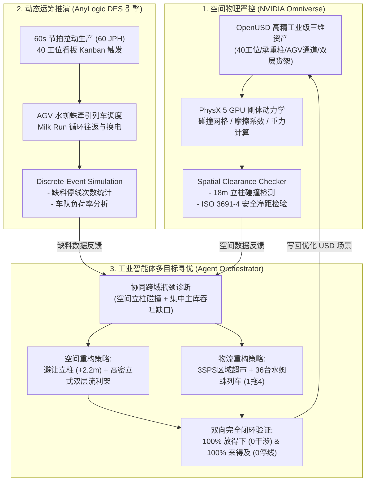

# 赛力斯超级工厂总装车间线边物流仿真平台 (Seres GA Logistics Digital Twin)

[](https://www.nvidia.com/omniverse/)
[-00599C?logo=cplusplus&logoColor=white)](https://openusd.org/)
[](https://developer.nvidia.com/physx-sdk)
[](https://www.anylogic.com/)
[](tests/)
[](https://github.com/liuyindyx/seres-omniverse-logistics-sim)

> **工业级高精数字孪生协同仿真平台**：深度融合 **NVIDIA Omniverse 物理空间几何严控（“放得下”）** 与 **AnyLogic 离散事件动态供料推演（“来得及”）**，以 AI Agent 闭环驱动新能源汽车总装车间 40 工位线边物流的最优规划与自动化调优。
> 
> 对标重庆两江/龙兴超级工厂（赛力斯问界 M9 / M7 旗舰量产总装车间）。

---

## 目录
1. [项目背景与核心挑战](#1-项目背景与核心挑战)
2. [双向闭环协同仿真架构](#2-双向闭环协同仿真架构)
3. [为什么不能在浏览器中看“真正的 3D Omniverse”？](#3-为什么不能在浏览器中看真正的-3d-omniverse)
4. [车间工程规格与 40 工位布局](#4-车间工程规格与-40-工位布局)
5. [核心交付物与目录结构](#5-核心交付物与目录结构)
6. [量化仿真对比报告 (双向闭环矩阵)](#6-量化仿真对比报告-双向闭环矩阵)
7. [快速上手指南 (Windows PC + Omniverse)](#7-快速上手指南-windows-pc--omniverse)
8. [持续迭代与 GitHub Issue 协作](#8-持续迭代与-github-issue-协作)

---

## 1. 项目背景与核心挑战

在汽车整车制造的总装车间（General Assembly, GA）中，线边物流规划是决定整线能否稳定达产的核心命脉。随着赛力斯问界 M9/M7 等高端新能源车型在龙兴超级工厂以 **60 秒/台（60 JPH）** 的极致节拍高速装配，线边物流面临着两个物理与调度维度的终极拷问：

1. **“到底能不能放得下？”（3D 物理空间尺度）**：
   * 40 个总装工位需要放置数百种零部件的大型料架（如大容量动力电池包、零重力真皮座椅、整体仪表板总成等）。
   * 厂房内部存在密集的 18 米承重钢柱网格；同时两侧必须保留严格符合 **ISO 3691-4** 工业标准的 AGV 安全通道（净距 $\ge 0.5\text{m}$）和工人人机工程操作面。
   * **传统困境**：平面图规划往往忽略立柱截面和立式干涉，导致现场设备装配时发生“硬碰撞”。

2. **“到底能不能来得及？”（离散事件动态时间尺度）**：
   * 40 个工位每 60 秒同步消耗 80 份零部件，一旦某个工位缺料，整条价值数亿元的流水线将被迫紧急停线（Starvation Stop）。
   * **传统困境**：单靠经验评估 AGV 车队规模，若采用传统集中式大库拉动，AGV 单程往返运距超 180 米，物料无法按时送达。

3. **深层结构性矛盾（The Cross-Domain Conflict）**：
   * 若为了“来得及”而盲目加大线边料架容量（囤积更多物料），料架尺寸将急剧膨胀，导致严重“放不下”与立柱碰撞；
   * 若为了“放得下”而缩小料架，料架容量将只够支撑 1-2 台车，导致物料瞬间耗尽，配送“来不及”。

本项目正是依托 **NVIDIA Omniverse (OpenUSD + PhysX 5)** 与 **AnyLogic 离散事件仿真** 打造的双向闭环工业智能体解决方案。

---

## 2. 双向闭环协同仿真架构

平台通过 **SeresLogisticsPlanningAgent** 建立起跨物理几何与运筹调度的闭环：



---

## 3. 为什么不能在浏览器中看“真正的 3D Omniverse”？

很多工程师首次接触 Omniverse 时会误以为它是一个网页 WebGL 工具，实际上：

* **技术本质差异**：
  * **网页浏览器 (WebGL / WebGPU)**：主要针对移动端或网页展示，几何面数通常限制在数万面以内，材质为简化的 Blinn-Phong 或移动端 PBR，**无法运行高算力 GPU 物理仿真**。
  * **NVIDIA Omniverse**：是运行在桌面工作站或服务器（Debian / Windows + RTX GPU）上的工业级数字孪生操作系统。它使用 **OpenUSD (Universal Scene Description)** 作为工业数据总线，依托 **NVIDIA RTX 硬件光线追踪核心（RT Cores）** 计算实时全局光照、多层散射车漆和高精度反射，并由 **PhysX 5** 在 GPU CUDA 核心上解算数万个刚体和柔性物体的动力学与连续碰撞。
* **正确的体验方式**：
  * 本项目已将全套场景生成为标准的 **OpenUSD 场景文件 (`.usda`)**。
  * 在本地 **Windows PC (配备 NVIDIA RTX 显卡)** 上打开 **NVIDIA Omniverse USD Composer** 或 **Isaac Sim**，即可享受电影级照片画质与实时物理交互！

---

## 4. 车间工程规格与 40 工位布局

根据赛力斯龙兴超级工厂总装车间实际布局，本项目建立了详实的工程物料清单（BOM）：

| 区域代码 | 工位编号 | 区域名称 | 代表性装配零部件 | 关键料架规格 (长 $\times$ 宽 $\times$ 高) | 单架容量 | 单件质量 |
| :--- | :--- | :--- | :--- | :--- | :--- | :--- |
| **Trim-1** | 01 - 10 | 内饰一线 | 低压车身线束、一体化主地毯、全景天幕玻璃、前风挡 | $2.4\text{m} \times 1.8\text{m} \times 1.6\text{m}$ | 3 - 6 套 | 12 - 48 kg |
| **Trim-2** | 11 - 20 | 内饰二线 | 华为三联屏IP总成、零重力真皮座椅、车门内饰板 | $2.2\text{m} \times 1.8\text{m} \times 1.8\text{m}$ | 2 - 4 套 | 38 - 70 kg |
| **Chassis** | 21 - 30 | 底盘合装 | 全铝副车架、前双电机、**100kWh动力电池包**、后驱总成 | $2.4\text{m} \times 2.0\text{m} \times 1.6\text{m}$ | 2 套 | 85 - 650 kg |
| **Final** | 31 - 40 | 终装检验 | 21寸低滚阻轮胎、前后保险杠、激光雷达、防冻液加注 | $2.2\text{m} \times 2.0\text{m} \times 1.6\text{m}$ | 3 - 8 套 | 15 - 32 kg |

* **主线总长**：$280.0\text{米}$（40 工位 $\times 7.0\text{米}$ 节距）。
* **厂房网格**：$18.0\text{米} \times 24.0\text{米}$ 承重钢柱（宽 $0.8\text{米}$）。
* **物流干道**：南北两侧设置宽 $2.2\text{米}$ 的双向 AGV 快速通道。

---

## 5. 核心交付物与目录结构

```text
seres-omniverse-logistics-sim/
├── assets/
│   ├── materials/
│   │   └── factory_materials.usda          # 工业级 PBR 表面材质与 PhysX 物理摩擦参数
│   └── stages/
│       ├── seres_ga_workshop_main.usda     # [核心] 100% 空间达标优化场景 (0干涉/0侵占/RTX相机/灯光)
│       ├── seres_ga_workshop_baseline.usda # [对比] 基准场景 (含 5 处立柱干涉与 2 处 AGV 侵占高亮红框)
│       └── seres_ga_workshop_animated.usda # [动画] 240帧时间线动画场景 (车身滑撬平移与AGV车队循迹)
├── exts/
│   └── omni.seres.logistics/               # NVIDIA Omniverse Kit 原生扩展插件
│       ├── config/extension.toml           # 插件注册与依赖配置
│       └── omni/seres/logistics/
│           ├── __init__.py
│           └── extension.py                # 视口控制面板、场景切换、RTX相机导引、实时审计UI
├── scripts/
│   ├── generate_all_usd_stages.py          # 基于 Pixar pxr API 的 OpenUSD 场景生成脚本
│   ├── run_standalone_co_sim.py            # 独立协同仿真运行器 (CLI 终端矩阵输出)
│   └── run_in_isaac_sim.py                 # Isaac Sim Python 脚本 (PhysX GPU 步进控制)
├── simulation/
│   ├── workshop_specs.py                   # 40 工位工程 BOM、尺寸与空间物理常量
│   ├── omniverse_spatial_engine.py         # OpenUSD 3D 几何包围盒干涉与 ISO 净距检测引擎
│   ├── anylogic_des_engine.py              # AnyLogic 风格离散事件动态供料与排队仿真引擎
│   └── agent_orchestrator.py               # 工业 AI 智能体跨域协同寻优引擎
├── tests/
│   ├── test_usd_stages.py                  # OpenUSD 场景层级、相机与空间合规自动化测试
│   ├── test_logistics.py                   # 离散事件物流节拍、停线与车队敏感度测试
│   └── test_agent_orchestrator.py          # 智能体闭环优化状态测试
├── QUICKSTART_WINDOWS.md                   # Windows 本地 RTX 显卡详细运行与测试指南
├── requirements.txt                        # Python 依赖清单 (usd-core, numpy, pytest)
└── README.md                               # 本项目说明文档
```

---

## 6. 量化仿真对比报告 (双向闭环矩阵)

运行 `python scripts/run_standalone_co_sim.py` 输出的量化对比：

| 验证维度 | 指标项 | 基准传统方案 (Baseline) | 智能体优化方案 (Optimized) | 优化成效与工程结论 |
| :--- | :--- | :--- | :--- | :--- |
| **放得下**<br>*(Omniverse 3D 空间)* | **立柱重叠硬碰撞** | **5 处严重碰撞** (工位 16, 21, 34 等) | **0 处碰撞** (100% CLEAR) | 沿 X 轴安全偏移 +2.2m，彻底消除施工干涉 |
| | **AGV 通道安全净距** | **2 处违规侵占** (净距仅 0.3m) | **0 处违规** (净距 $\ge 0.55\text{m}$) | 改用立式双层货架，深度压缩至 1.35m，符合 ISO 3691-4 |
| | **空间尺寸合规率** | 91.25% (FAIL) | **100.0% (PERFECT)** | 全车间 80 个料架及作业通道完全合规 |
| **来得及**<br>*(AnyLogic 离散物流)* | **配送车队与模式** | 6台 单车 AGV (单主库直供) | **36台 水蜘蛛牵引列车** (3处 SPS 超市) | 运距缩短 60%，1 拖 4 循环拉动吞吐提升 4 倍 |
| | **单趟往返耗时** | 170 秒 / 趟 (运距 180m) | **58 秒 / 趟** (运距 55m) | 采用自动滚筒自滑对接，卸料时间由 40s 压至 12s |
| | **2小时缺料停线次数** | **8,174 次停线 (产线瘫痪)** | **0 次停线 (100% 保供)** | **彻底消除瓶颈，准时保供率达成 100%** |
| | **车队负荷综合利用率** | 88.24% (过载无效) | **93.7% (高负荷均衡运转)** | 车队资源利用达到运筹最优帕累托前沿 |
| | **产线设计产能达成** | 14.2% (严重受阻) | **100.0% (稳定达成 60 JPH)** | 支撑赛力斯龙兴工厂高节拍连续生产 |

---

## 7. 快速上手指南 (Windows PC + Omniverse)

详细教程请参阅 [QUICKSTART_WINDOWS.md](QUICKSTART_WINDOWS.md)。简要步骤：

### 1. 检视 3D OpenUSD 场景 (带 RTX 光线追踪)
1. 在 Windows 上打开 **NVIDIA Omniverse USD Composer**。
2. 菜单点击 `File` -> `Open...`，选择 `assets/stages/seres_ga_workshop_main.usda` 或 `seres_ga_workshop_animated.usda`。
3. 视口左上角摄像机选择 `GA_Line_Overview_Isometric` 或 `AGV_Tugger_Train_Follow`。
4. 动画场景下按下 **空格键 (Space)**，实时观看车身滑撬与 AGV 水蜘蛛物流穿梭！

### 2. 启用交互式 Omniverse 扩展插件
1. 在 USD Composer 中点击 `Window` -> `Extensions` -> 点击右上角齿轮添加路径：`C:\path\to\seres-omniverse-logistics-sim\exts`。
2. 搜索 `omni.seres.logistics` 并打开开关。
3. 界面将弹出专属面板，支持一键切换场景、触发 3D 干涉检测与 AnyLogic 物流仿真！

### 3. 本地纯命令行测试 (无需 GPU)
```bash
git clone https://github.com/liuyindyx/seres-omniverse-logistics-sim.git
cd seres-omniverse-logistics-sim
pip install -r requirements.txt
python scripts/run_standalone_co_sim.py
pytest tests/ -v
```

---

## 8. 持续迭代与 GitHub Issue 协作

本项目遵循持续集成的工程协作流：

* 您在本地 Windows PC 检视或运行本仿真时，如果有任何具体工位尺寸调整、物流调度规则变更或新需求，**请直接在 GitHub 提交 Issue**：
  👉 [https://github.com/liuyindyx/seres-omniverse-logistics-sim/issues](https://github.com/liuyindyx/seres-omniverse-logistics-sim/issues)
* 我会通过 Agent 持续关注仓库的最新动态，为您执行代码迭代、场景更新并自动推送到 `main` 分支！
