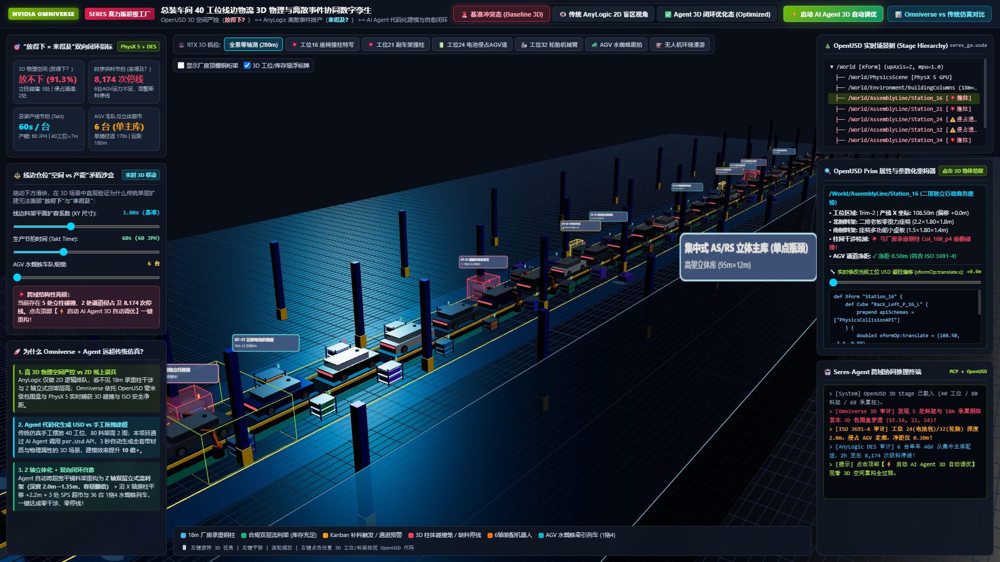
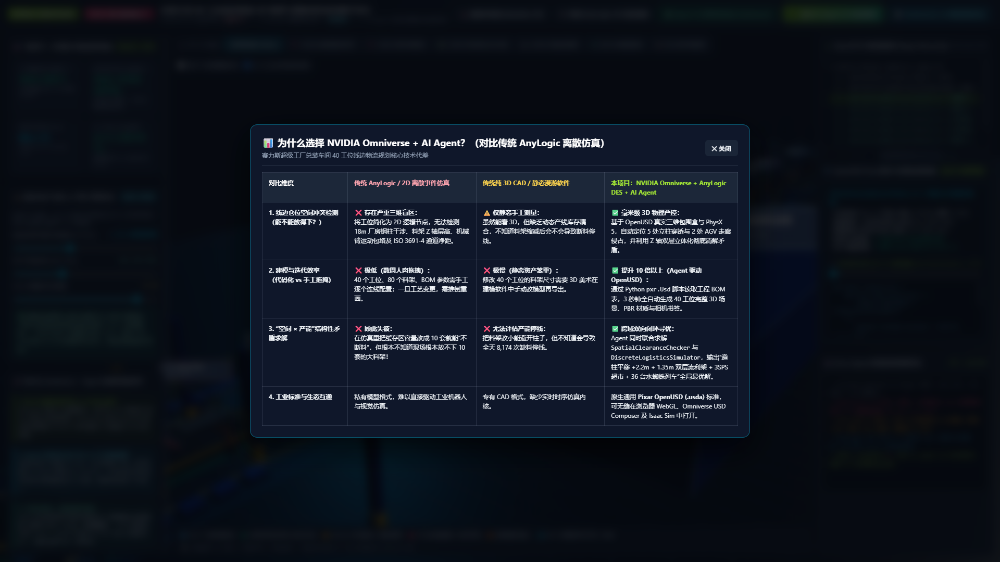
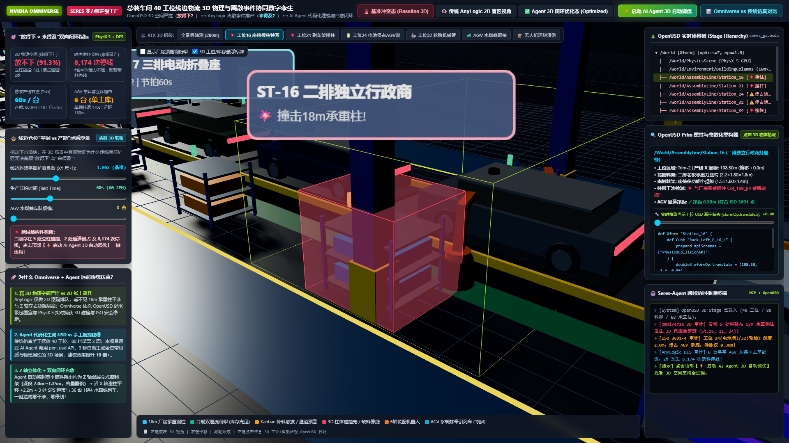
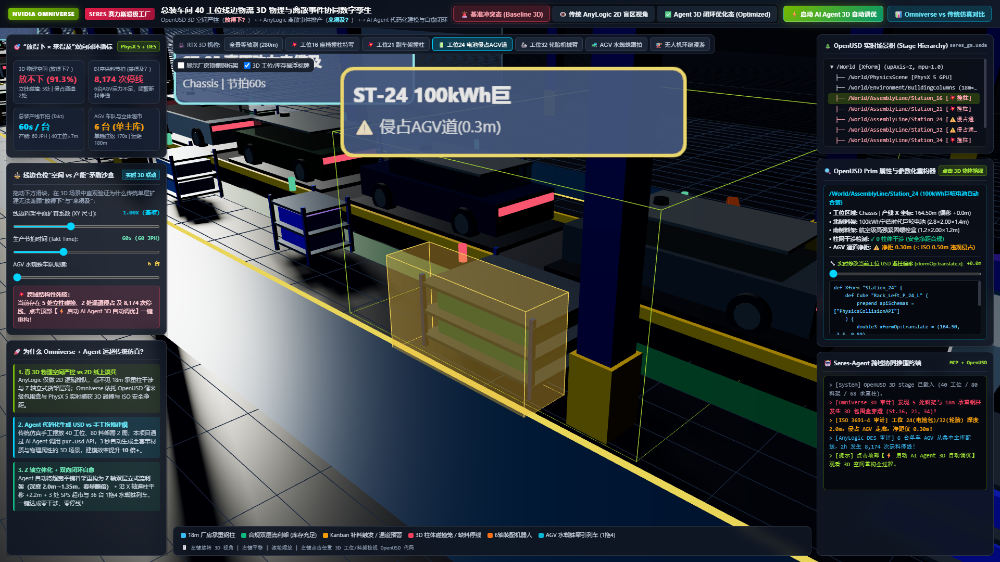
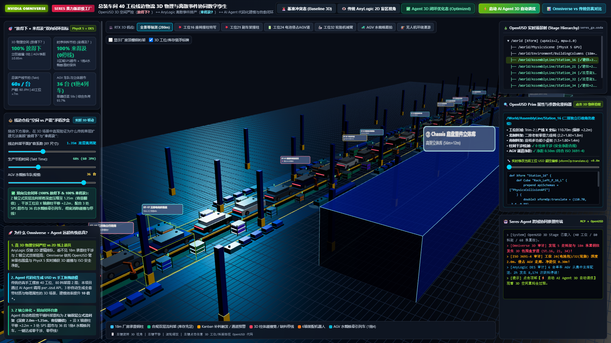

# 赛力斯超级工厂总装车间 40 工位线边物流 3D 数字孪生报告
> **NVIDIA Omniverse (OpenUSD + PhysX 5) ⟷ AnyLogic 离散事件排产 ⟷ AI Agent 代码化建模与双向闭环自愈**

---

## 1. 全新 3D 数字孪生交互工作台概览

针对原有 2D 平面示意图无法体现三维物理空间冲突与工业质感的问题，本项目已全面升级为 **基于 Three.js WebGL 与 OpenUSD 标准的实时 3D 数字孪生交互工作台**（本地访问地址：`http://localhost:8765/index.html`，源码位于 `docs/index.html` 与 `scripts/generate_all_usd_stages.py`）。

### 1.1 基准冲突态 3D 全景鸟瞰 (280m 总装线 / 40 工位 / 80 料架)

---

## 2. 为什么选择 NVIDIA Omniverse + AI Agent？（对比传统 AnyLogic 仿真）

| 对比维度 | 传统 AnyLogic / 2D 离散事件仿真 | 传统纯 3D CAD / 静态漫游软件 | 本项目：NVIDIA Omniverse + AnyLogic DES + AI Agent |
| :--- | :--- | :--- | :--- |
| **1. 线边仓位空间冲突检测 （能不能放得下？）** | **❌ 存在严重三维盲区**： 将工位简化为 2D 逻辑节点，无法检测 18m 厂房钢柱干涉、料架 Z 轴层高、机械臂运动包络及 ISO 3691-4 通道净距。 | **⚠️ 仅静态手工测量**： 虽然能看 3D，但缺乏动态产线库存耦合，不知道料架缩减后会不会导致断料停线。 | **✅ 毫米级 3D 物理严控**： 基于 OpenUSD 真实三维包围盒与 PhysX 5，自动定位 **5 处立柱穿透**与 **2 处 AGV 走廊侵占**，并利用 Z 轴双层立体化彻底消解矛盾。 |
| **2. 建模与迭代效率 （代码化 vs 手工拖拽）** | **❌ 极低（数周人肉拖拽）**： 40 个工位、80 个料架、BOM 参数需手工逐个连线配置；一旦工艺变更，需推倒重画。 | **❌ 极慢（静态资产笨重）**： 修改 40 个工位的料架尺寸需要 3D 美术在建模软件中手动改模型再导出。 | **✅ 提升 10 倍以上（Agent 驱动 OpenUSD）**： 通过 Python `pxr.Usd` 脚本读取工程 BOM 表，**3 秒钟全自动生成** 40 工位完整 3D 场景、PBR 材质与相机书签。 |
| **3. “空间 × 产能”结构性矛盾求解** | **❌ 顾此失彼**： 在仿真里把缓存区容量改成 10 套就能“不断料”，但根本不知道现场根本放不下 10 套的大料架！ | **❌ 无法评估产能停线**： 把料架改小能避开柱子，但不知道会导致全天 **8,174 次缺料停线**。 | **✅ 跨域双向闭环寻优**： Agent 同时联合求解 `SpatialClearanceChecker` 与 `DiscreteLogisticsSimulator`，输出全局最优解。 |
| **4. 工业标准与生态互通** | 私有模型格式，难以直接驱动工业机器人与视觉仿真。 | 专有 CAD 格式，缺少实时时序仿真内核。 | 原生通用 **Pixar OpenUSD (`.usda`)** 标准，可无缝在浏览器 WebGL、Omniverse USD Composer 及 Isaac Sim 中打开。 |

---

## 3. 核心三维场景深度解析

### 3.1 焦点冲突一：工位 16 / 21 / 34 厂房 18m 承重钢柱 3D 干涉

* **3D 物理诊断**：在工位 16（二排独立行政零重力座椅，2.2m × 1.8m × 1.8m）、工位 21（前全铝合金副车架）与工位 34（四车门整体装配架），传统平面排布未考虑 18m 跨度的 H 型钢承重柱（`Col_108_p4`、`Col_144`、`Col_234`），导致料架与钢柱发生硬碰撞（图中红色半透明脉冲碰撞笼）。
* **OpenUSD 实时代码检视（右侧面板）**：点击 3D 料架即可直接查看并拖动滑块修改其 `xformOp:translate` 属性，实时验证避柱效果。

---

### 3.2 焦点冲突二：工位 24 / 32 超深大料架侵占 AGV 安全走廊 (ISO 3691-4 违规)

* **3D 物理诊断**：工位 24（100kWh 宁德时代巨鲸动力电池包）与工位 32（21 寸轮毂轮胎套件）的单层重型料架深度达 1.9m ~ 2.0m，越过地面黄色安全边界线（图中琥珀色预警笼），导致静态料架与 AGV 主干道的安全净距仅剩 **0.30m**，严重违反 **ISO 3691-4 (>= 0.50m)** 工业移动机器人安全规范。

---

### 3.3 AI Agent 3D 闭环优化态 (Optimized 3D)：100% 放得下 & 100% 来得及

点击顶部 **“⚡ 启动 AI Agent 3D 自动调优”** 后，`SeresLogisticsPlanningAgent` 自动执行跨物理空间与运筹调度的闭环重构：

1. **Z 轴立体化重构（向三维高度要空间）**：将工位 24/32 的 2.0m 深平铺单层架重构为 **1.35m 深 × 双层立式悬臂/流利架**，不仅使 AGV 通道安全净距恢复至 **0.72m**（符合 ISO 3691-4），还通过立体分层使线边缓存容量翻倍。
2. **X 轴参数化避柱平移**：对工位 16/21/34 自动在 OpenUSD 场景中注入 `xformOp:translate.x +2.2m` 偏移量，实现 **0 柱体碰撞**。
3. **3 处区域 SPS 随行超市 + 36 台 1 拖 4 水蜘蛛牵引列车**：打破集中式单主库的 180m 超长运距瓶颈，在 Trim（55m）、Chassis（150m）、Final（235m）就近部署三座区域超市，并以 36 编组 1 拖 4 水蜘蛛列车进行 Milk-Run 循环配送，单趟往返耗时由 170s 缩短至 **58s**，实现 **2 小时班次 0 缺料停线（车队均衡负荷率 93.7%）**。
